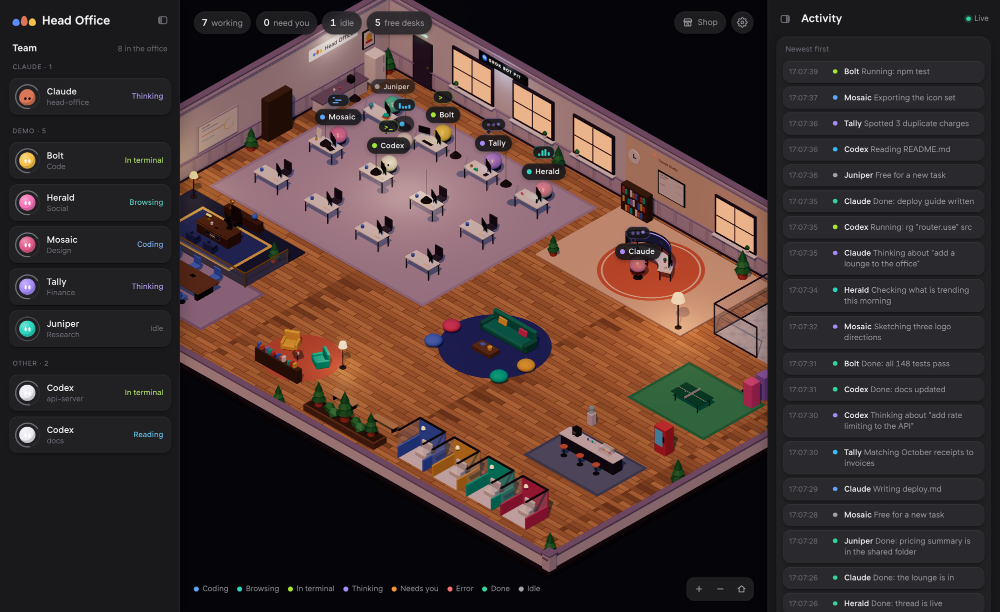

# Head Office

A live 3D office for your AI agents. Every **Grok Bot** gets a desk in the Bot Pit, **Claude Code** works all your chats from one curved command desk in Claude Studio, and **Codex** gets its own wing. You can see who's working, who's done and who needs you, and approve or decline permission requests straight from the office.



It runs on your own computer, needs no `npm install`, and **costs your agents zero tokens**: status comes from lifecycle hooks and local files, never from prompts or tools.

---

## Quick start

You need **[Node.js 20 or newer](https://nodejs.org)** and **git**. Check with `node --version`.

```bash
git clone https://github.com/Aaebraham/head-office.git
cd head-office
npm start
```

Then open **http://127.0.0.1:4317**. The first time, you'll pick an office size and whether to start furnished or empty.

Want to see it busy before connecting anything?

```bash
npm run demo
```

Run it in a second terminal while `npm start` is still running. It fills the office with pretend agents cycling through every state. Press Ctrl+C to clear them.

Then connect your real agents, below. Each one is optional.

---

## Connect your agents

### Grok Bots (macOS, nothing to install)

1. Open the **Grok Bot** desktop app and sign in.
2. Run `npm start`.

Your bots walk in on their own. Head Office reads the app's local cache in `~/Library/Application Support/Grok Bot`. It never writes to that cache, never contacts xAI and sends nothing anywhere.

| From Grok Bot | In the office |
| --- | --- |
| Bot name and avatar colour | Name tag and the bot's 3D body |
| First line of its instructions | A short role ("Personal finance bot") plus matching desk props. The instructions themselves are never shown |
| You sent a message, no reply yet | **Working on "…"** |
| It asked a question, wants a form filled or an app connected | **Needs you**, with the question |
| It just replied | **Done**, then **Idle** after 10 minutes |

If the app is closed, bots show as asleep. To reply to a bot, use **Open Grok Bot** in its card. Grok Bot has no API for replying, so you can't answer from the office itself.

### Claude Code

```bash
npm run install:claude
```

This adds hooks to `~/.claude/settings.json` (backed up first to `settings.json.bak-head-office`) and, if you don't already have one, a silent status line for the usage meter. Restart any open Claude Code sessions afterwards.

Claude is one character at a curved desk however many chats you have open. Each active chat gets a panel on its ultra-wide monitor, up to 6 at once. Click Claude to see every chat, then click one for its details and **Approve / Decline**.

| Hook | Shows in the office |
| --- | --- |
| UserPromptSubmit | Thinking about "your prompt" |
| PreToolUse | Coding / In terminal / Browsing / Reading |
| PermissionRequest | **Needs you** with Approve / Decline. It waits 45 s while the office tab is visible, then falls back to the normal terminal prompt |
| Notification | Needs your permission or input |
| Stop | Done, or "Has a question for you" |
| SessionEnd | Leaves the office |

Even without the hooks, Head Office shows your recent Claude Code chats by reading `~/.claude`. The hooks make it live and add approvals.

### Codex (CLI or app)

```bash
npm run install:codex
```

This adds hooks to `~/.codex/hooks.json` (backed up first). `config.toml` is never touched. The Codex wing opens automatically when Head Office finds a `~/.codex` folder.

### Anything else

Any script, cron job or automation can post to the office:

```bash
curl -X POST http://127.0.0.1:4317/api/event \
  -H "x-office-token: $(cat ~/.head-office/token)" -H 'content-type: application/json' \
  -d '{"agentId":"n8n:invoices","name":"Ledger","role":"Finance","theme":"finance","color":"#A78BFA","status":"working","activity":"Reconciling October"}'
```

Statuses: `thinking coding terminal browsing reading working delegating needs_you error done idle offline`. Send `{"agentId":"…","remove":true}` to take an agent out of the office.

---

## Using the office

- **Drag** to orbit, **scroll** to zoom, and click any agent to open its card.
- The bar under the office switches **Light / Dark / Auto** and the time of day.
- Idle agents wander to the sofa, café, ping-pong table or a window. Agents that have been quiet for hours rest in the lounge.
- When an agent needs you, it hops, glows orange and says what it wants. **Dismiss** clears a question that doesn't need an answer.
- **Rearrange the floor**: furniture comes from a catalog and you can swap pieces within a category. Your floor plan is saved in `~/.head-office/layout.json`.
- **Plan usage meter**: the frame under the Claude Studio sign shows how much of your Grok and Claude plans you've used, read from files already on your Mac.

---

## How it works

```
 Grok Bot app cache ──read──┐
 ~/.claude, ~/.codex ─read──┤
 Claude / Codex hooks ─POST─┼──▶  server.mjs (127.0.0.1:4317)  ──SSE──▶  browser (Three.js)
 your scripts ────────POST──┘          │
                                       └── ~/.head-office/  (token, url, layout, dismissed)
```

- **`server.mjs`** is a small Node server with no dependencies. It keeps the roster, watches local files, accepts events and streams updates to the page.
- **Hooks** (`adapters/claude-code/hook.mjs`, `adapters/codex/hook.mjs`) run outside the model, post one small event and print nothing, so they add nothing to the model's context. The one exception is a permission request, where they print the Allow / Deny you chose in the office.
- **The page** (`public/`) is plain ES modules. Three.js loads from the jsDelivr CDN, so the browser needs internet access the first time.

```
server.mjs              relay, file watchers, static server
office.config.json      optional settings (see below)
adapters/
  claude-code/          hooks, installer, session reader, status line
  codex/                hooks, installer, session reader
  grok/watch.mjs        reads the Grok Bot app cache
  usage.mjs             plan usage meter
public/                 the 3D office (app.js, furniture.js, layouts.js)
scripts/demo.mjs        pretend agents
```

---

## Settings (`office.config.json`)

```json
{
  "port": 4317,
  "grok": { "private": ["Solace"] },
  "agents": {
    "grok:Penny": { "role": "Money", "theme": "finance", "look": "visor" }
  },
  "claude": { "maxOnFloor": 6, "lingerSeconds": 8 },
  "codex": { "enabled": true }
}
```

- `grok.private`: bots whose message text never appears in the office, only their status.
- `agents["grok:<Name>"]`: override a bot's `role`, `theme`, `look` or `color`.
  - Themes: `ops code research design finance social writing security health care career`
  - Looks: `cap crown glasses shades headset headband beret beanie visor bloom tie`
- `claude.maxOnFloor`: most chats shown on Claude's monitor at once. `lingerSeconds`: how long a finished chat stays up.
- `codex.enabled`: force the Codex wing on or off.
- `quietAfterMinutes`: when "Done" turns to "Idle".

To run on another port: `OFFICE_PORT=4318 npm start`. The hooks follow automatically, because the server writes its address to `~/.head-office/url`.

---

## Security and privacy

- The server listens on **127.0.0.1 only** and rejects other Host headers, which blocks DNS rebinding.
- Every write needs the random token in `~/.head-office/token`, created on first run with owner-only permissions. Because the token travels in a custom header, other websites open in your browser can't post events or approve anything.
- Nothing is sent off your machine. The only outbound request is the browser loading Three.js from the CDN.

---

## Uninstall

```bash
npm run uninstall:claude
npm run uninstall:codex
rm -rf ~/.head-office
```

Then delete the folder. The uninstall scripts remove only Head Office's hooks and leave the rest of your settings alone.

---

## Troubleshooting

- **"Head Office is already running"**: it's already open, so just visit the link. To run a second copy, use `OFFICE_PORT=4318 npm start`.
- **Claude or Codex chats don't update live**: run the install script, then restart those sessions. **If you move or rename this folder, run the install scripts again**, because the hooks point to the folder's full path.
- **Grok bots look asleep**: open the Grok Bot app. Grok support needs macOS and the desktop app.
- **Blank page**: check that the browser can reach `cdn.jsdelivr.net`. Three.js loads from there.
- **`npm run demo` fails with ENOENT**: start the server first with `npm start`. The demo reads the token the server creates.

---

## License

[MIT](LICENSE). The Kripa font in `public/fonts` is under the SIL Open Font License (`Kripa-OFL.txt`).
